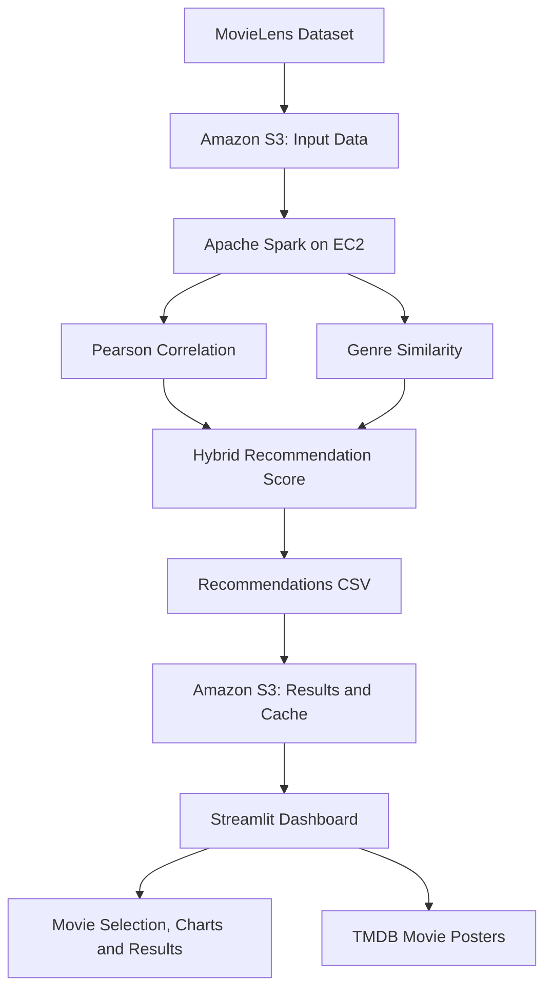

# Movie Recommendation System using Apache Spark

A Big Data Analytics project that recommends movies using user rating patterns and genre similarity.

## Features
- Multi-movie selection for personalized recommendations.
- Apache Spark processing of MovieLens ratings.
- Hybrid recommendation scoring using Pearson correlation and genre similarity.
- Interactive Streamlit dashboard with charts, sorting, and TMDB movie posters.
- Amazon S3 storage for datasets and persistent recommendation caching.
- Cached results are reused to avoid repeating Spark computations.

## Technology Stack
- Python and PySpark
- Apache Spark
- Amazon S3 and EC2
- Streamlit, Pandas, and Plotly
- TMDB API for movie posters

## Project Structure
```text
movie-recommendation/
├── dashboard/
│   ├── app.py
│   └── requirements.txt
├── screenshots/
│   ├── dashboard-overview.png
│   ├── recommendation-results.png
│   ├── movie-posters.png
│   └── dashboard-cache.png
├── recommend_movies_multi.py
├── README.md
└── .gitignore
```

## Setup
1. Install Java 17, Apache Spark, and Python.
2. Install dashboard dependencies with `pip install -r dashboard/requirements.txt`.
3. Configure `dashboard/.env` with your S3 bucket, AWS region, and TMDB API key.
4. Configure AWS permissions securely, preferably with an EC2 IAM role.
5. Ensure the Spark script and dashboard paths match your environment.
6. Run the dashboard from its directory:
```bash
python -m streamlit run app.py --server.address 0.0.0.0 --server.port 8501
```

## S3 Configuration
The Spark script currently reads MovieLens data from `s3a://movie-recommendation-spark-jay-2026/ml-10m/`.
Update the input path if you use a different bucket.
The EC2 IAM role needs read access to the input data and read/write access to the recommendation cache.

## Recommendation Workflow
1. Select movies in the dashboard.
2. Generate a versioned cache key from the selected movie IDs.
3. Load recommendations from S3 if the cache exists.
4. Otherwise, run Spark and save the resulting CSV to S3.

## System Architecture



## Recommendation Algorithm

The system combines collaborative filtering with movie genre similarity to rank recommendations.

### 1. Pearson Correlation

Pearson correlation measures the similarity between the ratings of two movies from users who rated both. The system requires at least 20 common users and keeps positive correlations.

### 2. Confidence Adjustment

Correlations based on fewer shared users are given less weight:

\[
C = r \times \frac{n}{n+50}
\]

Where:
- \(r\) is the Pearson correlation.
- \(n\) is the number of common users.
- \(C\) is the confidence-adjusted correlation.

### 3. Genre Similarity

Jaccard similarity measures the overlap between the genre sets of two movies:

J(A, B) = |A ∩ B| / |A ∪ B|

Here, (A) and (B) are the sets of genres for the two movies.

### 4. Final Recommendation Score

The system combines confidence-adjusted correlation and genre similarity:

**Formula:**

S = (0.7 * C) + (0.3 * J)

Where:
- S = Final recommendation score
- C = Confidence-adjusted correlation score
- J = Genre similarity score (Jaccard similarity)

**Weight Distribution:**
- Correlation confidence contributes 70% (0.7).
- Genre similarity contributes 30% (0.3).

The final score combines both factors to generate recommendations.

### 5. Ranking and Caching

Recommendations are ranked using the selected-movie matches, final score, and total common users, following the implementation's ranking order. Results are stored in Amazon S3 and reused when a matching versioned cache entry exists.


## Dataset and Disclaimer
The project uses MovieLens data. Follow the dataset provider terms of use.
Recommendation scores are heuristic ranking signals and are not guaranteed measures of user preference.
This project is intended for educational and demonstration purposes.

## Screenshots

### Dashboard Overview


### Recommendation Graphs


### Recommendation Results


### Movie Poster Gallery


## Live Demo

Try the Movie Recommendation System here:

**[Open Movie Recommendation Dashboard](http://13.54.124.12:8501)**

The demo runs on AWS EC2 and may be unavailable when the instance is stopped.
